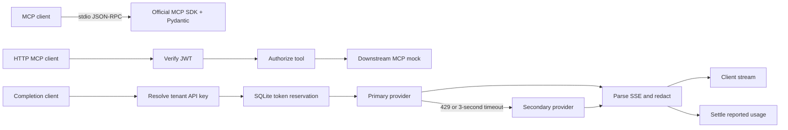

# Design notes

## Request paths

## MCP protocol and authorization

The SDK owns initialization, sessions, tool discovery, request dispatch, and
stdio transport. Its normal tool decorator returns validation failures inside a
tool result. The assessment explicitly asks for JSON-RPC errors, so tool calls
are registered at the request-handler layer and raise `McpError(-32602)`.

A small input adapter handles malformed JSON and unknown methods before the SDK
sees them. It shares a locked output writer with the SDK, so protocol errors and
normal replies cannot interleave. Validation errors disclose field names rather
than submitted values. Synthetic business data keeps the demo reproducible.

The HTTP proxy verifies an HS256 JWT before looking at the requested tool. It
never derives authority from an unsigned payload or from the literal token text.
Issuer and audience prevent reuse of a token intended for another service. A
denied tool call is rejected before opening a downstream connection.

The HTTP proxy implements the task's JSON-RPC POST profile. Notifications are
forwarded without a JSON-RPC reply; denied notifications are dropped with HTTP
204. Batch requests are rejected. Full Streamable HTTP MCP sessions, OAuth
discovery, and SSE responses from downstream MCP servers are outside this
profile. Production integration would add those at this boundary.

## Why the redactor holds a word

A chunk ending in `alice` might be followed by `@example.com`. Once `alice` has
been sent, a later match cannot take it back. The redactor therefore keeps an
unfinished ASCII word or numeric run until a delimiter makes it safe to classify.
Ordinary words are emitted as soon as their boundary arrives. Card numbers can
span spaces or hyphens, so their numeric run stays together.

The pending candidate is capped at 512 characters. When that cap is reached, the
whole candidate is replaced and its remaining characters are discarded until a
boundary. This is deliberately conservative: a very long harmless word can also
be redacted. There is no timer that flushes an ambiguous prefix. Such a timer
would trade data protection for latency.

Coverage is conventional ASCII emails, hyphenated US SSNs, and 13–19 digit card
numbers with optional spaces/hyphens. Card detection does not require a Luhn
checksum: a typo should not cause a likely card number to leak. These patterns
are not a complete DLP classifier. Quoted/internationalized email addresses,
obfuscated identifiers, and arbitrary Unicode representations need additional
normalization and policy tests.

HTTP chunks are not SSE events, and SSE events are not individual words. The
parser handles fragmented lines, CRLF, comments, multiple `data:` lines, and
UTF-8 split across network chunks. It limits each event to 64 KiB. Only text
content is emitted; upstream metadata is not copied around the filter. A missing
`[DONE]` is an error. On interruption, the unfinished candidate is discarded.
The generator uses downstream backpressure and closes the upstream on exit.

## Quota reservation and settlement

Quota state is an indexed event table in on-disk SQLite. Every admission deletes
expired events, sums the tenant's remaining usage, checks the new reservation,
and inserts it within one immediate transaction. Two workers cannot both spend
the same remaining budget. Blocking SQLite operations run in worker threads,
leaving the event loop available for HTTP streams.

Usage belongs to a half-open time window: events at or before `now - 60` expire.
Wall-clock timestamps survive restart; system clocks should be synchronized.
Reservations are replaced, not incremented, when actual usage arrives. Failed
or cancelled work stays charged because a timeout does not prove that the remote
provider performed no work. No API key, prompt, or response is stored in SQLite.

Input reservations use a byte upper bound for byte-level model tokenizers, plus
16 request-framing tokens and 8 per message. Output reserves `max_tokens`.
These framing constants belong to the adapter contract and must be checked for
each new provider. An exact tokenizer can replace the estimator without changing
the SQLite transaction. Authoritative usage can exceed an estimate; settlement
records it in full, so subsequent requests see the overage. The gateway cannot
retroactively prevent an upstream provider from ignoring its output limit.

The quota is per logical completion. A timeout followed by fallback can incur
provider charges twice; an accounting ledger for billing must record each
attempt separately. The current ledger is for request admission, not invoicing.
Each reservation is bounded by the request's admission window. With the default
3-second attempts and 30-second stream cap, work finishes within that window;
operators should preserve that relationship when changing timeouts.

## Fallback and stream failures

Non-streaming primary requests have a total 3,000 ms deadline, including body
read. HTTP 429 and timeout trigger one secondary attempt. Other statuses return
a sanitized error. `asyncio.timeout` cancels the losing coroutine rather than
leaving an unobserved task running. The secondary also has a finite deadline.
Caller cancellation propagates and does not start a backup request.

For streaming, the initial deadline extends through the first nonempty text
delta. Fallback is allowed at that point because no text has reached the client.
Once streaming begins, a provider failure sends a sanitized SSE `error` event
and closes the stream. Restarting on another model mid-answer could duplicate
or contradict the text already delivered. The initial HTTP status cannot be
changed after stream headers have been sent. A read-idle timeout and a total
stream timeout bound stalled or endless providers.

## Deployment notes

- Replace demo credentials and serve behind TLS. HS256 is deliberately small for
  this exercise; production identity integration should use an issuer's JWKS,
  key rotation, and explicit claim mapping.
- Provider URLs and credentials are operator configuration. Client tokens are
  never forwarded upstream, and redirects are disabled. Use outbound network
  allowlists and secret injection in the deployment environment.
- SQLite needs a persistent local filesystem with correct permissions. WAL is
  suitable for one host with multiple workers, not independent pods sharing NFS.
  A distributed deployment should move the same atomic reservation operation to
  an appropriate shared datastore.
- Logs contain request IDs, HTTP method, status, and header latency. They omit
  tokens, prompts, PII, and raw provider bodies. A production deployment would add
  protected audit events for authorization decisions and metrics for fallback,
  redaction, queue delay, and full stream duration.
- Body size, event size, output tokens, deadlines, and HTTP connection-pool size
  are bounded. Add an ingress concurrency limit and per-identity request limits
  before exposing the service publicly.
- For enterprise proxy or TLS failures, check DNS, outbound policy, proxy
  configuration, and CA trust separately. Never disable certificate validation.

## Role alignment

The exercise emphasizes the field developer work described in the supplied job
description: Python integrations, customer identity boundaries, reproducible
failures, deployment configuration, and maintainable tests. The modules mirror
QuilrAI's public [LLM and MCP gateway responsibilities](https://quilr.ai/platform/for-engineers).
The implementation follows the assessment's exact behavior where it differs
from a broader product feature; for example, discovery remains transparent even
when invocation is restricted.
